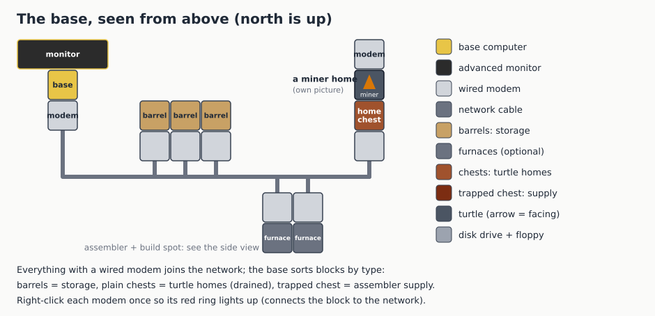
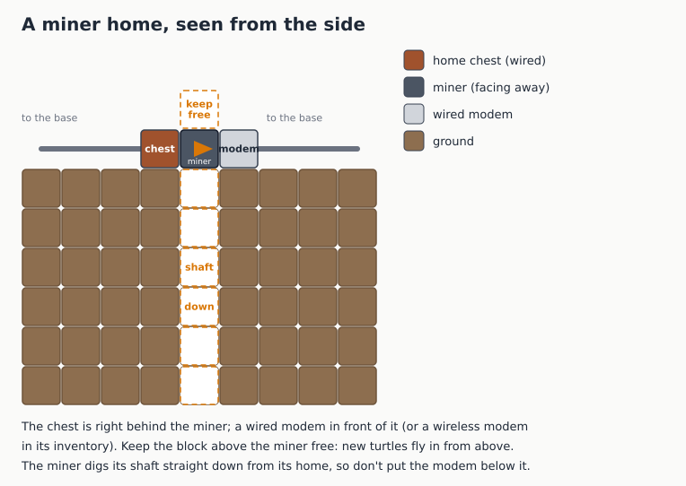
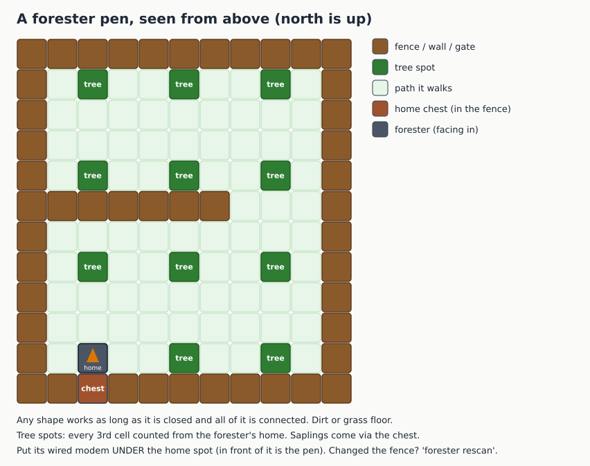
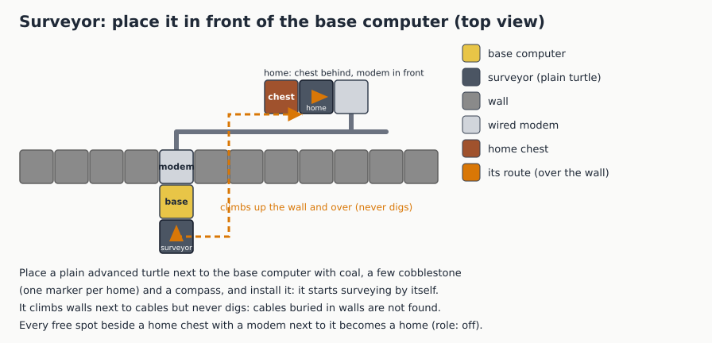
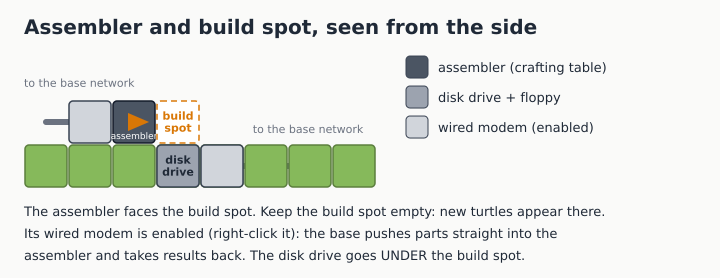
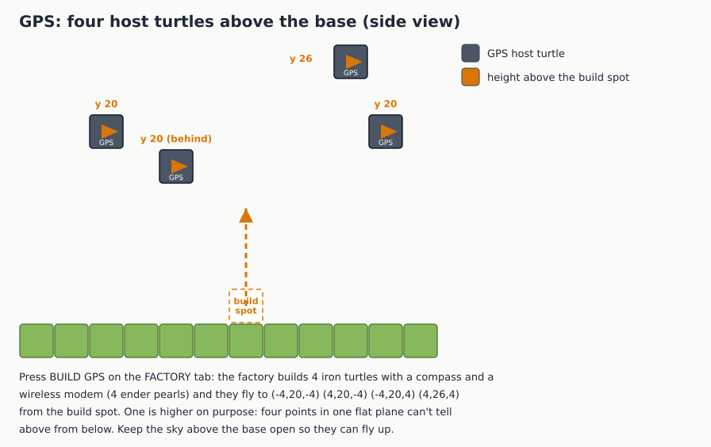

# Setting up cc-factory, step by step

Build it in this order: each step works on its own, and the later ones need
the earlier ones. Made for All The Mods 10 (Minecraft 1.21.1, CC: Tweaked,
Advanced Peripherals, All The Ores).

**One rule for everything on the network:** a block joins the base's network
through a **wired modem** on it, connected by **network cable** to the base
computer. **Right-click each modem once** so its red ring lights up: the chat
then says the block is connected. A modem that isn't lit does nothing.

## 1. The base computer



- An **advanced computer** with an **advanced monitor** (4 wide × 3 high is
  comfortable) and a **wired modem**.
- On the computer, run:

  ```
  wget run https://raw.githubusercontent.com/ErikTMA/cc-factory/main/bootstrap.lua
  ```

  It downloads everything and starts the base (it also starts by itself after
  a server restart). It keeps itself up to date: every 30 minutes it checks
  GitHub for a new version and updates itself, and every turtle gets the new
  code the next time it is home. `base update` updates right away;
  `autoUpdate = false` in `factory.cfg` turns automatic updates off. Settings are in `factory.cfg` (`edit factory.cfg`, then
  `reboot`).
- The base sorts what's on its network **by block type**, no configuration:

  | Block | What the base does with it |
  |---|---|
  | barrel | storage |
  | chest (plain) | a turtle's home chest: emptied into storage every 10 s |
  | furnace / blast furnace | smelting |
  | disk drive with a floppy | the installer disk |

## 2. The first miner (by hand)



- Craft an **advanced turtle**, then craft it together with a **diamond
  pickaxe** (left of it) and a **Geo Scanner** (right of it).
- Build its home: a plain **chest** behind it and a **wired modem** in front
  of it (cabled to the base), or give it a **wireless modem** in its inventory.
  Keep the block above it free. The miner digs its shaft straight down from
  here.
- Put coal in it and run:

  ```
  wget run https://raw.githubusercontent.com/ErikTMA/cc-factory/main/bootstrap.lua miner
  ```

  It asks for its Y once (F3), then waits for jobs. Send it one from the
  monitor's **GATHERING > MINING** tab.

## 3. Storage, furnaces, stock rules

- Add **barrels** (storage) and **furnaces** with modems. The base keeps the
  furnaces fuelled and smelts raw ore, logs into charcoal, cobblestone into
  stone and sand into glass.
- **Stock rules** in `factory.cfg` keep items in stock by queuing mining jobs:

  ```lua
  rules = {
    { item = "minecraft:raw_iron", min = 256, job = { only = "iron", y = 16, quantity = 64 } },
  },
  ```
- **HAMMER** on the FACTORY tab doubles ores with an All The Ores ore hammer
  (1 raw ore → 2 dust → 2 ingots). The base crafts the hammer itself.
- **TINY FUEL** on the FACTORY tab makes the furnaces burn tiny charcoal (or
  tiny coal) instead of whole pieces: the assembler crafts it (1 → 8) and each
  furnace gets exactly one per item it smelts (a blast furnace one per two),
  so nothing burns away when a furnace runs out of work. It's for furnaces
  only: for a turtle 8 tiny coal are worth exactly one coal, so turtles get
  whole coal first. Tiny coal from Utilitarian and Actually Additions both
  count as fuel everywhere.
- **Fuel on request:** a turtle low on fuel asks the base, and the base pushes
  charcoal (then coal, then tiny) from storage straight into it. That only works
  while the turtle touches a **wired modem that is enabled** (right-click it
  while the turtle is there: the chat says the turtle is connected). A modem
  switches itself **off** when the last block it connects goes away, and a
  turtle leaving counts: so the turtle's modem must touch something else too,
  like its home chest or a barrel (which just becomes extra storage); then it
  stays on and reconnects the turtle every time it comes home. Miners
  ask at home, foresters after a round, the surveyor makes a trip to the
  nearest modem it knows.

## 4. Foresters



- A forester is an advanced turtle with a **diamond pickaxe** and a
  **compass**.
- Fence off a pen. Put the forester inside, facing in, with its chest
  directly behind it (in the fence line), a wired modem **under the chest**
  (right-click it) and one **under the forester** (no right-click needed);
  the two modems connect to each other. Give it coal and a stack of **dirt**;
  saplings can go anywhere in it, or let the base deliver them (below).
- First start: it walks the pen once and remembers it. On the way it fells the
  trees already inside, clears grass, flowers and mushrooms, fills holes and
  water with dirt, and swaps stone under tree spots for dirt. Then it plants
  a grid of tree spots counted from the pen's corner, one cell in from the
  fence (a path runs along it). The spacing depends on the tree: 3 for oak,
  birch, spruce and jungle; 4 for menril (its base is wider, and it only grows
  with dirt under its 4 side cells, which the forester lays); 5 for acacia,
  cherry and mangrove (their branches reach sideways); 4 for other modded
  saplings. Mixed kinds share the widest spacing; dark oak (needs 2x2) isn't
  planted. It keeps its dirt (never unloads it); tree spots it had no
  dirt for are fixed in a later round once you give it more. Other solid blocks
  inside the pen count as walls. Run `forester rescan` after changing the
  fence.
- **The home chest is a mailbox.** Once the forester has unloaded there, the
  base knows the chest is its home and keeps **saplings, bone meal and fuel**
  in it; the forester takes them when it comes home, then drops its wood. On
  the monitor, **GATHERING > FORESTRY**: tap the sapling kinds to plant
  (several: the base puts the same amount of each in the chest and the
  forester plants them **in turn**, so you get a mix; none selected: the kind
  storage has most of), and switch **BONE MEAL** on or off. Miners' home
  chests get fuel the same way. Amounts: `mailbox` in `factory.cfg`.

## 5. The surveyor: let the base find the homes



Instead of typing coordinates, let a turtle find the homes:

- Build each home as in steps 2 and 4: chest behind, modem next to the spot.
- Place a **plain advanced turtle** (no upgrades needed) **next to the base
  computer** (beside it or on top). Put in its inventory: some **coal**, a few
  **cobblestone** (one per home) and a **compass** (4 iron + 1 redstone; it
  fits the compass itself so it knows which way it faces). Then right-click it
  and run:

  ```
  wget run https://raw.githubusercontent.com/ErikTMA/cc-factory/main/bootstrap.lua surveyor
  ```

  It installs, restarts and starts surveying by itself. It looks at every side
  of every cable, modem and chest it finds, starting with the base computer,
  so it follows the cables wherever they go: it climbs walls, goes over and
  round them, never digs, and stays within 32 blocks (16 up or down) of where
  it started. It burns coal or charcoal from its inventory; with nothing to
  burn it says so and carries on after you add some and `reboot` it. Before
  every trip out it checks it has fuel to get back and to visit the homes it
  found; when it runs short it stops exploring and finishes. It writes what it
  does to `surveyor.log` (`edit surveyor.log` to read it). If it can't get back
  to where it started it says why and tries again after a `reboot`;
  `surveyor home` sends it back. A new `surveyor survey` refuses while it is
  stranded (so its map isn't lost); if you carried it back yourself, run
  `surveyor survey here`. It drops a cobblestone into each home chest so
  the base knows which chest it is, and registers the homes. It also finds the
  installer disk drive, which tells the base where the build spot is. (No
  compass? Then run `surveyor north`, with the way it faces from F3.) To survey
  again later: `surveyor survey`.
- On the monitor's **FACTORY** tab, **tap a home** to set its role: miner,
  forester or off.

Cables buried inside walls, with no open air next to them, are not found.
Use the chat fallback for those (step 8).

## 6. The assembler: the base builds turtles



- An advanced turtle with a **crafting table**, facing the **build spot** (keep
  it empty), touching a **wired modem** on the base's network (behind it, under
  it or on top). **Right-click that modem with the assembler in place**: the
  base then pushes the parts straight into the assembler and takes the results
  back out, so no chest is needed. A wireless modem is optional. A **disk
  drive with a floppy** goes **under the build spot**: never next to the
  assembler. Install it with `bootstrap.lua assembler`.
- Set a fleet target in `factory.cfg`, e.g. `fleet = { miner = 3 }`, and give
  each new turtle a home (step 5, or `homes` in `factory.cfg`).
- The base then crafts every part from storage, the assembler builds the
  turtle, and it installs itself from the disk, flies home and starts working.
  Raw inputs it needs: raw ores, diamonds, redstone, coal, cobblestone, sand,
  logs, and **nether quartz** (for the Geo Scanner's observer: bring that
  yourself).

## 7. GPS



- Press **BUILD GPS** on the FACTORY tab (needs the assembler). The factory
  builds four GPS turtles (iron turtle + compass + wireless modem each, so 4
  ender pearls) and they fly to their points high above the build spot.
- With GPS, any turtle with a wireless modem knows where it is. To give a
  turtle a home, stand it on the spot facing the right way (chest behind it)
  and run `home miner` (or `home forester`): it registers the spot and starts
  working there.

## 8. Chat fallback (for big existing bases)

If the surveyor can't reach your cables and you have no GPS yet: put a **Chat
Box** and a **Player Detector** (Advanced Peripherals) next to the base.

- Stand **on the build spot** and type `$build` in chat.
- Stand **on a home spot**, look the way the turtle should face, and type
  `$home miner` (or `$home forester`, or just `$home` and pick the role on the
  monitor).
- `$homes` lists the homes, `$removehome <id>` removes one, `$help` shows all.

## When something doesn't work

| Symptom | Check |
|---|---|
| the base doesn't see a chest or furnace | its modem's red ring is lit (right-click it) |
| a turtle never gets a job | its home has a modem next to it, or it carries a wireless modem |
| the assembler waits forever | FACTORY tab shows which raw items are missing |
| a turtle installs itself again and again | the disk drive must be under the build spot, not next to the assembler |
| the surveyor misses a home | a modem next to the home spot, the chest is a plain chest, the cable is reachable from open air |
| the forester says "not closed" | a gap in the fence; fix it and run `forester rescan` |
